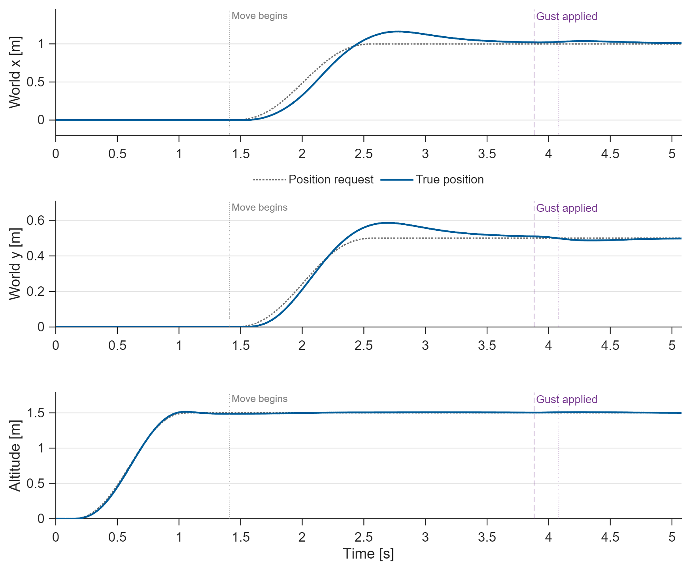
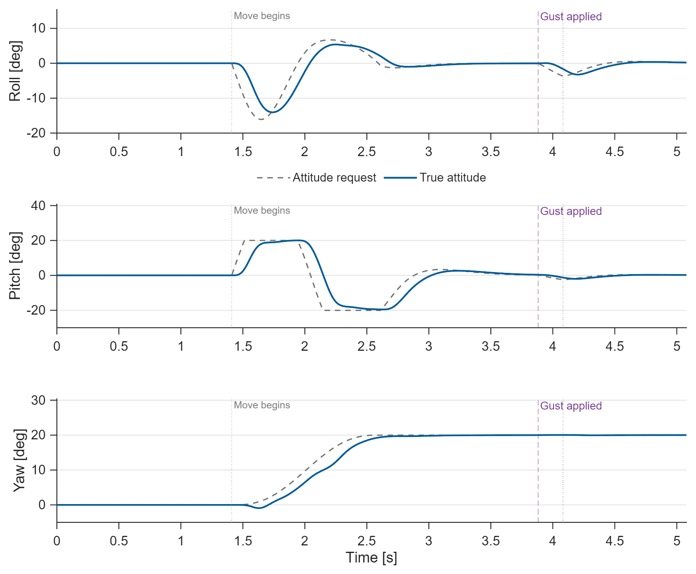
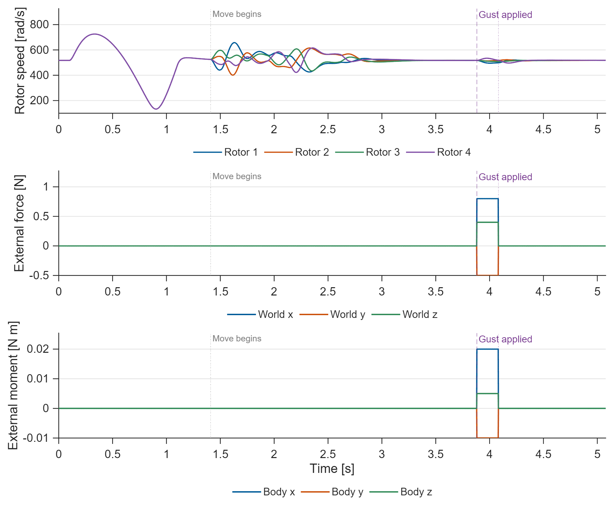

# Quadcopter Attitude and Altitude Control

Nonlinear six-degree-of-freedom flight with four motor states, an X-configuration
mixer, position PD, altitude PID, angle feedback and body-rate PI control.
The experiment includes takeoff, translation/yaw motion, and an independent gust.

## Run

Requires **MATLAB and Simulink**; verified on **R2025b**.
Open this folder and run `run_demo` or `run_demo(false)`.
Edit `project_parameters.m`. The editable model is `quadcopter_control.slx`.

## Results

**Figure 1. Staged flight.** The vehicle takes off to 1.5 m, then moves to
[1, 0.5, 1.5] m after takeoff settles. The translation starts at 1.410 s.
The force/moment gust starts at 3.882 s, after the move settles, and ends
at 4.082 s. The common endpoint is 5.078 s.

**Figure 2. Cascaded attitude control.** Lateral position feedback requests roll
and pitch; the yaw request moves to 20 degrees. Rate PI loops supply body moments.
All attitude requests and actual angles are shown through gust recovery.

**Figure 3. Actuation and disturbance channels.** Motor speeds include a 25 ms
first-order response and a 900 rad/s limit. The gust is [0.8, -0.5, 0.4] N in world
coordinates and [0.02, -0.01, 0.005] N m in body coordinates.

## Model and checks

State order is world position, world velocity, roll/pitch/yaw, body rates, then
four rotor speeds. World and body z axes point upward in hover. `flight_rhs.m`
contains translation, Euler kinematics, rigid-body rotation and motor lag.
`flight_controller.m` allocates total thrust and moments through the full-rank
mixer and applies anti-windup when allocation is limited.

Timing checks all sixteen physical states. Position uses 2% of the maneuver
amplitudes; velocity, attitude, rates and motor speeds use 2% excursions with
explicit floors for unexcited axes. The gust follows move settling by one saved
sample. A 10% recovery tail follows the last settled state; see `results/timing.json`.

`run_demo` checks the Simulink trace against a piecewise ODE solution, mixer rank,
rotor/attitude bounds, final recovery and a rigid-body energy balance. Final
position error is 9.52 mm in this test.

The model uses ideal state measurements, known mass/inertia and near-hover
Euler-angle control. Ground contact, rotor gyroscopic moments, sensor fusion
and hardware flight software are not included. Normal simulation mode is used.
CSV traces, figures, parameters and metrics are in `results/`. [MIT License](LICENSE).
